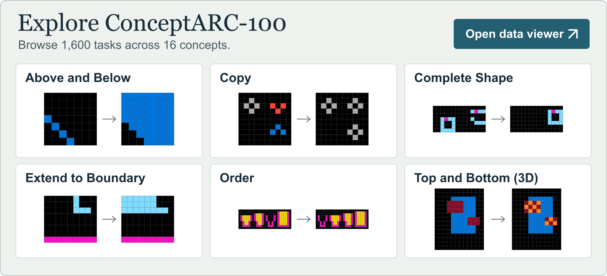
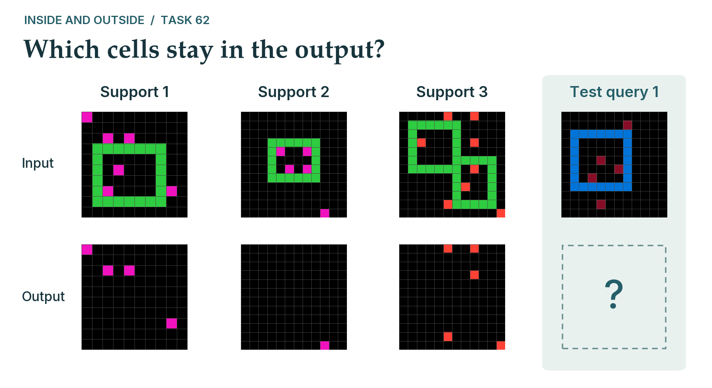
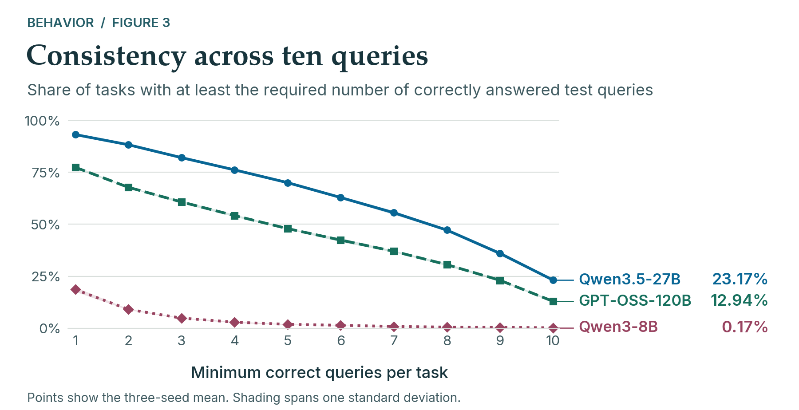
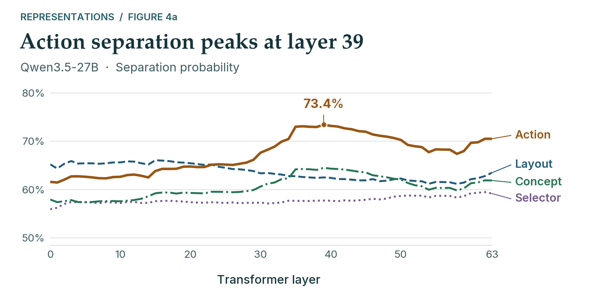
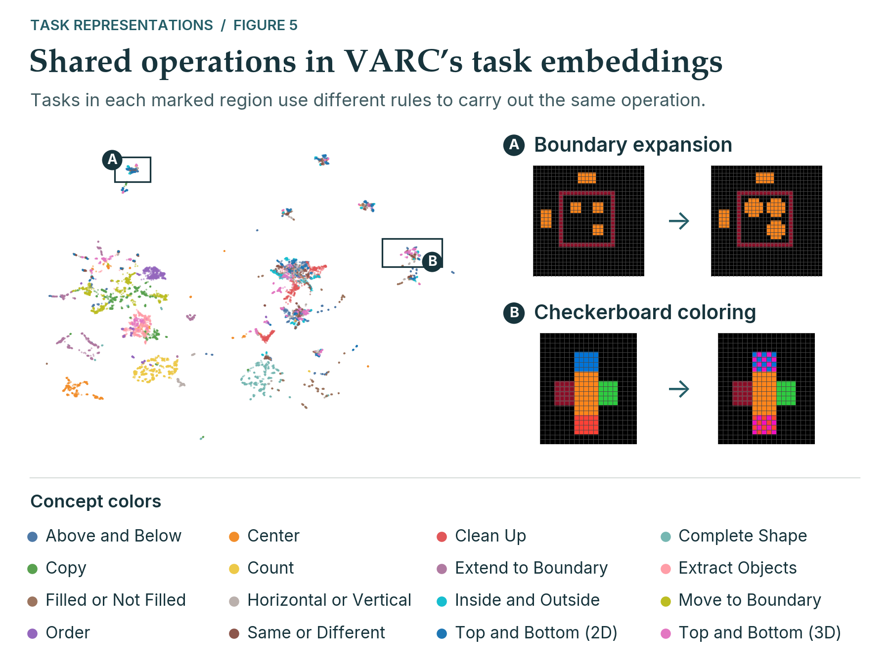

# ConceptARC at Scale

Do large reasoning models form abstractions that generalize across diverse reasoning tasks? In the Abstraction and Reasoning Corpus (ARC), each puzzle asks the solver to infer a grid transformation from a few input–output examples ([Chollet, 2019](https://arxiv.org/abs/1911.01547)). Different transformations can draw on the same concept. For example, recoloring lines inside a container and removing pixels between two lines both require reasoning about spatial containment. To study how models handle such shared concepts, we build a task generator to create **ConceptARC-100**. The benchmark contains 1,600 manually reviewed ARC-style tasks, 100 for each of the 16 concepts defined by ConceptARC ([Moskvichev et al., 2023](https://arxiv.org/abs/2305.07141)). The code in this repository evaluates model performance across these concepts and examines how models represent tasks from different concepts in their representation space.

[Paper](https://arxiv.org/abs/2611.06732) | [Project page](https://mainlp.github.io/conceptarc-100-project-page/index.html) | [Hugging Face dataset](https://huggingface.co/datasets/mainlp/ConceptARC-100) | [Interactive data viewer](https://mainlp.github.io/conceptarc-100-project-page/data_viewer.html) | [BibTeX](#citation)

<p align="center">
  <a href="https://mainlp.github.io/conceptarc-100-project-page/data_viewer.html">
    <picture>
      <source media="(max-width: 600px)" srcset="assets/data-viewer-preview-mobile.png">
      
    </picture>
  </a>
</p>

| I want to… | Start here | Paper |
| --- | --- | --- |
| Try a model on one task and inspect its ten answers | [Set up](#1-set-up), [get the data](#2-get-the-data), then [try one task](#3-try-one-task) | §3 and Appendix C.1 |
| Compare accuracy by concept and consistency across queries | [Evaluate models and summarize scores](#4-evaluate-models-and-summarize-scores) | Tables 1, 3–4 and Figure 3 |
| Extract hidden states, visualize tasks, and measure layer-wise separation | [Extract task representations](#5-extract-task-representations) and [analyze them](#6-analyze-task-representations) | Figures 4a, 6–9, and 11 |
| Compare model states, hand-engineered visual features, and VARC task embeddings under the same controls | [Run the visual controls and baseline](#7-run-the-visual-controls-and-baseline) | §4.2 and Figures 4b, 5, 10, and 17–18 |

Steps 1–4 take you from three demonstrations to ten scored answers. Steps 5–7 use eight support sets per task to study the model’s representations. You can begin that experiment as soon as you have the data from step 2.

## 1. Set up

Clone this repository or download and unpack its ZIP. Open a Bash shell in the directory that contains `pyproject.toml` and use a current patch release of Python 3.12. Downloading the data, scoring existing generations, summarizing scores, and analyzing saved features all run on CPU.

```bash
python3.12 -m venv .venv
source .venv/bin/activate
python -m pip install -e .

DATA_ROOT=data
OUTPUT_ROOT=output
CONFIG_DIR=arc_cd/models/model_config
```

Keep these variables in the same shell for the steps below. You can point `DATA_ROOT` and `OUTPUT_ROOT` at any writable directories, including a separate storage volume. The scripts use the dataset directory names to identify runs, so keep the names created by the downloader.

**For generation and hidden-state extraction**, use a Linux machine with compatible NVIDIA GPUs. Install the inference extra in the same environment and check that PyTorch can see the GPUs.

```bash
python -m pip install -e '.[inference]'
python -c 'import torch; print("Visible GPUs:", torch.cuda.device_count())'
```

Choose a [model preset](arc_cd/models/model_config/) by its filename stem. The presets contain the public checkpoint IDs, chat settings, and decoding budgets from Appendix C.1. Generation defaults to one visible GPU. For tensor parallelism, set `model.tensor_parallel_size` in the YAML to the number of GPUs you intend to use. The model weights and configured context must fit your hardware. The Transformers extractor uses `--hf_device_map auto` by default.

To customize a checkpoint or GPU settings, run `cp -r "$CONFIG_DIR" model-configs`, then `CONFIG_DIR=model-configs` and edit the relevant YAML. Keep the preset filename as the run’s model name. To pin a model checkpoint, set `revision` under `model` to its Hugging Face commit. Set `HF_HOME` before logging in if you want the Hugging Face cache on another volume.

## 2. Get the data

Sign in on the [dataset page](https://huggingface.co/datasets/mainlp/ConceptARC-100), accept its access terms, then authenticate the same account on the machine that will download the data. A read token is sufficient.

```bash
hf auth login
python -m scripts.download_data --output_dir "$DATA_ROOT"
```

That command prepares the behavioral benchmark. Representation analysis and visual controls also use the eight-version data and task specifications.

```bash
python -m scripts.download_data --output_dir "$DATA_ROOT" --configs ConceptARC-100-8 ConceptARC-100-specs
```

| Directory under `DATA_ROOT` | Contents of the Hugging Face `test` split |
| --- | --- |
| `ConceptARC-100/` | 1,600 tasks. Each JSON file contains three support pairs and ten labeled test queries. |
| `ConceptARC-100-8/` | 12,800 task versions. Eight support sets for each task share the same ten ordered queries. |
| `ConceptARC-100-specs/` | 1,600 specifications. The analysis joins each task to its layout, selector, and action metadata by parent task ID. |

To match a task across directories, use the concept and the part of the filename before the version suffix. For example, `InsideOutside/InsideOutside62_001.json` is identical in both puzzle directories. Versions `_002` through `_008` change the support examples, and `InsideOutside/InsideOutside62.json` is the specification for all eight.

Each configuration is written to its own directory once the download completes. If a download fails, rerun the command with `--configs` naming only the unfinished configurations. To use a specific data release, pass the same `--revision` (a Hugging Face tag or commit) to both commands and choose a fresh data root.

## 3. Try one task

In **Inside and Outside, task 62**, the three support pairs give you everything the model sees about the rule. Look at the isolated cells in each input, then predict the first test output before opening the answer.

<p align="center">
  <a href="https://mainlp.github.io/conceptarc-100-project-page/data_viewer.html#/concept/InsideOutside/task/InsideOutside62_001">
    <picture>
      <source media="(max-width: 600px)" srcset="assets/inside-outside-task-mobile.png">
      
    </picture>
  </a>
</p>

<details>
<summary>Reveal the rule and check your prediction</summary>

Keep the single-cell markers outside every outline, in their original positions. On the first test grid, just two maroon cells remain. Counting rows and columns from one, they are at **(2, 8)** and **(11, 5)**. The other cells are black. Try the same rule on the remaining nine queries. [Open all ten queries in the viewer](https://mainlp.github.io/conceptarc-100-project-page/data_viewer.html#/concept/InsideOutside/task/InsideOutside62_001)

</details>

To try the model on this puzzle, copy its JSON to a one-task benchmark and run generation and scoring.

```bash
EXAMPLE="$DATA_ROOT/example/ConceptARC-100"
mkdir -p "$EXAMPLE/InsideOutside"
cp "$DATA_ROOT/ConceptARC-100/InsideOutside/InsideOutside62_001.json" "$EXAMPLE/InsideOutside/"

python -m scripts.run_arc_vLLM --data_dir "$EXAMPLE" --model_name qwen3_8b \
    --model_config_dir "$CONFIG_DIR" --seed 42 --output_dir "$OUTPUT_ROOT/example"

EXAMPLE_RUN="$OUTPUT_ROOT/example/concept_arc_100/qwen3_8b"
python -m scripts.eval_arc_acc --model_config_dir "$CONFIG_DIR" --input_jsonl \
    "$EXAMPLE_RUN/generations/seed_42/concept_arc_100_qwen3_8b_seed_42_generations.jsonl"
```

Check the ten answers with the command below. A correct answer requires a normally stopped response and an exact match in grid dimensions and cell values. The case file also contains each `predicted_grid` and `target_grid`.

```bash
python - "$EXAMPLE_RUN"/eval/seed_42/*_eval_cases.jsonl <<'PY'
import json
import sys

with open(sys.argv[1], encoding="utf-8") as stream:
    for line in stream:
        case = json.loads(line)
        outcome = "correct" if case["correct"] else "incorrect"
        print(case["case_id"], outcome, case["parse_status"], sep="\t")
PY
```

The first query is `InsideOutside/InsideOutside62_001/test_0`. In the companion `*_eval_summary.json`, check that `overall.n` is 10. The field `overall.n_correct` tells you how many queries this run solved.

## 4. Evaluate models and summarize scores

Use the same three seeds for each model. Start with one preset while setting up. Use all eight for the paper’s comparison.

| Model family | Available presets |
| --- | --- |
| Qwen3 and Qwen3.5 | `qwen3_8b`, `qwen3_32b`, `qwen35_9b`, `qwen35_27b` |
| GPT-OSS, high reasoning effort | `gpt_oss_20b`, `gpt_oss_120b` |
| Gemma and Phi | `gemma4_31b`, `phi4_reasoning_plus` |

```bash
MODELS=(qwen3_8b)
# Uncomment the next line for the full comparison.
# MODELS=(gemma4_31b qwen35_27b qwen35_9b gpt_oss_120b gpt_oss_20b qwen3_32b qwen3_8b phi4_reasoning_plus)
BENCHMARK="$DATA_ROOT/ConceptARC-100"
EVAL="$OUTPUT_ROOT/concept_arc_100"
```

Run this loop with the dataset and models you selected.

```bash
(
    set -e
    for MODEL in "${MODELS[@]}"; do
        for SEED in 42 44 46; do
            python -m scripts.run_arc_vLLM --data_dir "$BENCHMARK" --model_name "$MODEL" \
                --model_config_dir "$CONFIG_DIR" --seed "$SEED" --output_dir "$OUTPUT_ROOT"
            for run in "$EVAL/$MODEL/generations/seed_$SEED"/*_generations.jsonl; do
                python -m scripts.eval_arc_acc --model_config_dir "$CONFIG_DIR" --input_jsonl "$run"
            done
        done
    done
)
```

A complete run has 16,000 answers per model and seed. Generation saves the text JSONL, run config, and exact prompt/generated token IDs in a compressed NPZ sidecar. Each record’s `case_id` and `token_index` link it to its tokens. Keep the example run in its separate output directory so it is excluded from these summaries.

If you already have generations, start with the scoring command inside the loop. Keep each `*_generations.jsonl` beside its `*_config.json` so scoring uses the answer marker that was active during generation. For older runs without a saved marker, scoring reads the model preset. Keep the model and seed directory layout for the summary commands below.

```bash
python -m scripts.summarize_eval_seed_stats --input_folders "$EVAL"/*/eval
python -m scripts.plot_eval_concept_performance --dataset_root "$EVAL"
python -m scripts.plot_robustness --show_std --output_path "$EVAL/robustness.pdf" \
    --reference_json assets/robustness_reference.json \
    --input_csvs "$EVAL"/*/eval/global_summary/*_query_distribution_seed_stats_*.csv
```

| Result | Where to look |
| --- | --- |
| Overall, per-concept, predicate, and action accuracy | `$EVAL/concept_model_accuracy_comparison.json`. Each model has `overall`, `per_concept`, and `per_concept_group`. Values are fractions. The group statistics average the eight concept accuracies **within each seed**, then report the mean and sample SD across seeds. |
| Consistency across the ten queries | `$EVAL/robustness.pdf` and the CSVs in each model’s `eval/global_summary/`. At threshold 7, for example, the curve counts every task with **at least seven** correct answers. All tasks, including those with zero correct, enter the denominator. |
| Individual successes and failures | `$EVAL/<model>/eval/seed_<seed>/*_eval_cases.jsonl`. Each query appears once per run. |

The consistency plot combines your runs with the published VARC and TRM curves. Omit `--reference_json` to show only your runs. For Table 1, compare `per_concept` with the individual concept rows and `per_concept_group` with the predicate and action rows. [Explore accuracy by model and concept](https://mainlp.github.io/conceptarc-100-project-page/index.html#performance)

<p align="center">
  <a href="https://mainlp.github.io/conceptarc-100-project-page/index.html#consistency">
    <picture>
      <source media="(max-width: 600px)" srcset="assets/query-consistency-mobile.png">
      
    </picture>
  </a>
</p>

**Read Figure 3.** A task with seven correct answers contributes at thresholds 1 through 7. In the published results, Qwen3.5-27B solves at least one query on **93.21%** of tasks and all ten on **23.17%**. The three curves shown here give the mean across seeds, with bands of one sample standard deviation. Select models and move the threshold slider to inspect all ten curves. [Open the interactive consistency plot](https://mainlp.github.io/conceptarc-100-project-page/index.html#consistency)

<details>
<summary>Pooled query coverage across models and seeds (§4.1)</summary>

After scoring, pool the three seeds for each model in `MODELS`. Different runs can cover different queries of the same task. A task counts as fully covered when the union contains all ten correct answers. Use the full eight-model array from step 4 for the paper’s pooled LRM comparison.

```bash
python - "$EVAL" "${MODELS[@]}" <<'PY'
import json
import sys
from collections import defaultdict
from pathlib import Path

solved = defaultdict(set)
reference = None
for model in sys.argv[2:]:
    for seed in (42, 44, 46):
        folder = Path(sys.argv[1]) / model / "eval" / f"seed_{seed}"
        files = list(folder.glob("*_eval_cases.jsonl"))
        if len(files) != 1:
            raise ValueError(f"Expected one scored run in {folder}, found {len(files)}")
        cases = set()
        with files[0].open(encoding="utf-8") as stream:
            for line in stream:
                row = json.loads(line)
                case = row["case_id"]
                if case in cases:
                    raise ValueError(f"Repeated case {case} in {files[0]}")
                cases.add(case)
                covered = solved[row["task_id"]]
                if row["correct"]:
                    covered.add(case)
        if len(cases) != 16000 or (reference is not None and cases != reference):
            raise ValueError(f"{files[0]} must cover the same 16,000 queries as every run")
        reference = cases
if len(solved) != 1600:
    raise ValueError(f"Expected 1,600 ConceptARC-100 tasks, found {len(solved)}")
complete = sum(len(queries) == 10 for queries in solved.values())
print(f"{complete}/{len(solved)} tasks fully covered ({complete / len(solved):.2%})")
PY
```

</details>

<details>
<summary>Original ConceptARC (Table 4) and parallel runs</summary>

For Table 4, clone the [original ConceptARC corpus](https://github.com/victorvikram/ConceptARC) with `git clone https://github.com/victorvikram/ConceptARC "$DATA_ROOT/ConceptARC"`. Set `BENCHMARK="$DATA_ROOT/ConceptARC/corpus"` and `EVAL="$OUTPUT_ROOT/concept_arc"`, then run the same generation loop and the first two summary commands. Each task here has three test queries. To plot its consistency curve, replace `--reference_json assets/robustness_reference.json` with `--n_queries 3`. Compare the two datasets with `python -m scripts.plot_eval_dataset_comparison --dataset_roots "$OUTPUT_ROOT/concept_arc" "$OUTPUT_ROOT/concept_arc_100"`.

For independent generation jobs, add `--concept Count` (or a zero-based `--concept_index`) to the generation command. After all 16 concepts for a model and seed finish, set `MODEL` and `SEED` in your shell, for example `MODEL=qwen3_8b` and `SEED=42`. Then run `python -m scripts.merge_concept_generations --data_dir "$BENCHMARK" --shard_dir "$EVAL/$MODEL/generation_shards/seed_$SEED"` and score the merged generation file.

</details>

## 5. Extract task representations

Start here after preparing the eight-version data and task specs in step 2. Extraction reads the support grids directly. For example, `InsideOutside62_001` through `InsideOutside62_008` are eight versions of the same task. Each contributes one hidden state per layer at **S3**, the token containing the closing bracket of the third support output. The test query comes later in the prompt. The extractor also saves **S1** and **S2**, the corresponding positions for the first two supports.

```bash
MODEL=qwen35_27b
PROJECTION_LAYER=41
DATA="$DATA_ROOT/ConceptARC-100-8"
REPR="$OUTPUT_ROOT/concept_arc_100_8"
FEATURES="$REPR/$MODEL/probing/prompt_features/features"
RESULTS="$REPR/$MODEL/repr_analysis/paper"

python -m scripts.repr_analysis.extract_prompt_features --data_dir "$DATA" --model_name "$MODEL" \
    --model_config_dir "$CONFIG_DIR" --output_root "$OUTPUT_ROOT" --layers all
```

Look in `$FEATURES` for `S1.npz`, `S2.npz`, `S3.npz`, `manifest.jsonl`, `tokens.npz`, and `run_config.json`. The manifest aligns each feature row and token position to a support-set version. Layer numbers start at zero for the first transformer block. The extractor reads `hidden_states[layer + 1]` because entry zero holds the embedding states. To distribute extraction by concept, add `--concept` or `--concept_index` as in step 4, then run `python -m scripts.repr_analysis.merge_prompt_features --data_dir "$DATA" --shard_dir "$REPR/$MODEL/probing/prompt_features/shards"`.

## 6. Analyze task representations

Project the S3 task representations at Qwen3.5-27B layer 41 to obtain the UMAP shown in Figure 11. Join the task specs to this projection to get the labels for the separation analysis.

```bash
python -m scripts.repr_analysis.run_dimensionality_reduction \
    --feature_dir "$FEATURES" --output_root "$OUTPUT_ROOT" --run_name paper --positions S3 \
    --layers "$PROJECTION_LAYER" --methods umap --n_neighbors 15 --min_dist 0.1 --seed 42
python -m scripts.repr_analysis.run_metadata_explorer \
    --analysis_dir "$RESULTS/all/dimensionality_reduction" --spec_dir "$DATA_ROOT/ConceptARC-100-specs"
META="$RESULTS/all/metadata_explorer"
```

Open `$META/explorer.html` locally to inspect the projection and the support grids. To measure separation in the original hidden states, use **all** extracted layers.

```bash
for POPULATION in all predicate action; do
    python -m scripts.repr_analysis.run_cosine_distance --feature_dir "$FEATURES" --metadata_dir "$META" \
        --output_root "$OUTPUT_ROOT" --run_name paper --positions S3 --layers all \
        --population "$POPULATION" --comparison_scopes global
done
```

For each layer, the analysis centers the version vectors within the selected population and averages eight versions per parent task. It compares cosine distances from an anchor to tasks with shared and different labels. The paper uses `tie_adjusted` (half credit for a tie), averaged over anchors within a family and then equally over eligible families. Read `$RESULTS/<population>/metadata/cosine_distance/summary.csv` for the numbers or open the `figures/` subdirectory.

<p align="center">
  <a href="https://mainlp.github.io/conceptarc-100-project-page/index.html#representations">
    <picture>
      <source media="(max-width: 600px)" srcset="assets/layer-separation-mobile.png">
      
    </picture>
  </a>
</p>

**Read Figure 4a.** At layer 39 the published action score is **73.4%**. It measures how often a task is closer to another task sharing its action than to a task with a different action. In the `all` population’s CSV, select `position=S3`, `layer=39`, `scope=global`, `role=action`, and `metric=tie_adjusted`. [Explore the published layer curves](https://mainlp.github.io/conceptarc-100-project-page/index.html#representations)

For the remaining models in Figures 6–9, repeat steps 5–6 with `MODEL=gemma4_31b`, `gpt_oss_120b`, or `qwen35_9b`. Change the model **before** setting `FEATURES` and `RESULTS`. Set `PROJECTION_LAYER=0` for the metadata-building projection on those models. Only the Qwen3.5-27B illustration uses layer 41.

## 7. Run the visual controls and baseline

Use the Qwen3.5-27B paths from steps 5–6. Consider a reference task that removes corners. Compare it with a second corner-removal task and a third task with a different action. Layout and visual matching constrain the **second and third tasks**. The reference can look different from both. Freeze these comparisons once, then score S3 at every layer under the original condition and eight controls.

**How to reproduce the visual cutoffs.** Section 4.2 describes percentiles over eligible pair distances. The experiment calibrates each visual profile using one distance per positive task and action family with at least ten members, taken to its nearest eligible different-action task. It pools those distances, computes q25, q50, and q75, and retains **every eligible pair** strictly below each cutoff. The saved cutoffs are in `$MATCHES/matching_summary.json`. [See worked examples of visual matching](https://mainlp.github.io/conceptarc-100-project-page/index.html#visual-controls)

```bash
MATCHES="$RESULTS/action_matches"
python -m scripts.repr_analysis.run_matched_action_separation prepare \
    --data_dir "$DATA" --metadata_dir "$META" --output_dir "$MATCHES"
python -m scripts.repr_analysis.run_matched_action_separation evaluate \
    --match_dir "$MATCHES" --feature_dir "$FEATURES" --positions S3 --layers all \
    --reference_analysis_dir "$RESULTS/all/metadata/cosine_distance" \
    --output_dir "$RESULTS/matched_action" --qualitative_examples --data_dir "$DATA" --metadata_dir "$META"
```

The matching profiles use 42 coordinates for the three inputs, or 90 for the three input–output pairs. The **visual baseline** in Appendix D.2.1 uses a separate 132-coordinate representation built from geometry, color, spatial, and object features. The two commands below build this baseline and evaluate it on the same frozen comparisons.

```bash
python -m scripts.repr_analysis.run_visual_baseline \
    --data_dir "$DATA" --metadata_dir "$META" --output_root "$OUTPUT_ROOT" --run_name paper \
    --features geometry color spatial objects --support_aggregation concat --comparison_scopes global
VISUAL="$REPR/visual_features/repr_analysis/paper/features_geometry_color_spatial_objects/concat/all/metadata/cosine_distance"
python -m scripts.repr_analysis.run_matched_action_separation evaluate-visual \
    --match_dir "$MATCHES" --visual_dir "$VISUAL" --output_dir "$RESULTS/matched_visual"
```

Compare the `summary.json` and `figures/` in `$RESULTS/matched_action` and `$RESULTS/matched_visual`. The model run also writes reference, positive, and negative task triplets under `qualitative_examples/`. [See the illustrated controls on the project page](https://mainlp.github.io/conceptarc-100-project-page/index.html#representations)

<details>
<summary>Compare VARC’s learned task embeddings (§4.2)</summary>

The release includes the paper’s frozen VARC task centroids. Each of the 1,600 vectors has 512 coordinates and averages eight support-set embeddings. The following commands align them to the downloaded specifications by parent task ID and apply the same comparisons as above.

<p align="center">
  <a href="https://mainlp.github.io/conceptarc-100-project-page/index.html#inline-embedding">
    <picture>
      <source media="(max-width: 600px)" srcset="assets/varc-embedding-findings-mobile.webp">
      
    </picture>
  </a>
</p>

In **A**, the orange objects inside the outline grow. In **B**, alternating cells turn pink in the blue and red regions. To explore the clusters yourself, select two nearby points with different concept colors in the interactive map and compare their support grids. [Full Figure 5 in the paper](https://arxiv.org/pdf/2611.06732v1#page=10) · [Interactive VARC map](https://mainlp.github.io/conceptarc-100-project-page/index.html#inline-embedding)

```bash
CENTROIDS=arc_cd/repr_analysis/base_task_centroid_embeddings.npz
VARC="$REPR/varc/repr_analysis/paper"
python -m scripts.repr_analysis.run_cosine_distance \
    --centroid_file "$CENTROIDS" --model_name varc --metadata_dir "$META" \
    --output_root "$OUTPUT_ROOT" --run_name paper --comparison_scopes global
python -m scripts.repr_analysis.run_matched_action_separation evaluate-centroids \
    --match_dir "$MATCHES" --centroid_file "$CENTROIDS" --model_name varc \
    --output_dir "$VARC/matched_action"
```

Read `$VARC/all/metadata/cosine_distance/summary.csv` for unconstrained separation and `$VARC/matched_action/summary.json` for the controls. To plot the centered VARC embeddings by concept, use Figure 5’s UMAP settings of 30 neighbors and a minimum distance of 0.1. This example fixes the layout seed at 42 and writes `figures/varc_umap.pdf`.

```bash
python - "$VARC/all/metadata/cosine_distance" <<'PY'
import json
import sys
from pathlib import Path

import matplotlib.pyplot as plt
import numpy as np

from arc_cd.repr_analysis.embedding import EmbeddingOptions, embed_tasks

run = Path(sys.argv[1])
axes = json.loads((run / "axes.json").read_text())
labels = np.asarray(axes["labels"])
options = EmbeddingOptions(methods=("umap",), n_neighbors=30, min_dist=0.1, seed=42)
points = embed_tasks(np.load(run / "task_means.npy"), options)["coordinates"][0]

fig, ax = plt.subplots(figsize=(9, 6), layout="constrained")
for index, concept in enumerate(axes["concepts"]):
    x, y = points[labels == index].T
    ax.scatter(x, y, s=12, color=plt.get_cmap("tab20")(index), label=concept)
ax.set_axis_off()
ax.legend(loc="center left", bbox_to_anchor=(1, 0.5), frameon=False)
fig.savefig(run / "figures" / "varc_umap.pdf")
PY
```

The paper describes the VARC and TRM training experiments in §4.1.1 and Appendix C.2.

</details>

## Check the installation

These CPU tests use synthetic records to check grid scoring and query-count summaries.

```bash
python -m pip install -e '.[test]'
python -m pytest -q tests/test_eval_termination_diagnostics.py tests/test_plot_robustness.py
```

For the full offline unit suite, install `'.[inference,test]'` and run `HF_HUB_OFFLINE=1 python -m pytest -m 'not integration'`. Tokenizer checks that require an uncached checkpoint are skipped.

## License and figure credits

The repository and dataset are licensed under **Creative Commons Attribution-ShareAlike 4.0 International**.
[Repository license](LICENSE) | [License terms](https://creativecommons.org/licenses/by-sa/4.0/)

## Citation

If you use ConceptARC-100, its evaluation code, or the published results, please cite the paper. [Read on arXiv](https://arxiv.org/abs/2611.06732)

```bibtex
@misc{mondorf2026conceptarc,
  title         = {{ConceptARC} at Scale: Studying Conceptual Understanding in Reasoning Models},
  author        = {Mondorf, Philipp and Deliège, Adrien and LeGris, Solim and Beger, Claas and Yi, Ryan and Plank, Barbara and Lake, Brenden M. and Gureckis, Todd M.},
  year          = {2026},
  eprint        = {2611.06732},
  archivePrefix = {arXiv},
  primaryClass  = {cs.AI},
  doi           = {10.48550/arXiv.2611.06732},
  url           = {https://arxiv.org/abs/2611.06732}
}
```
